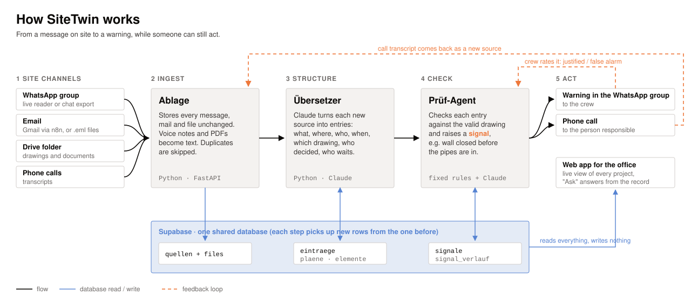
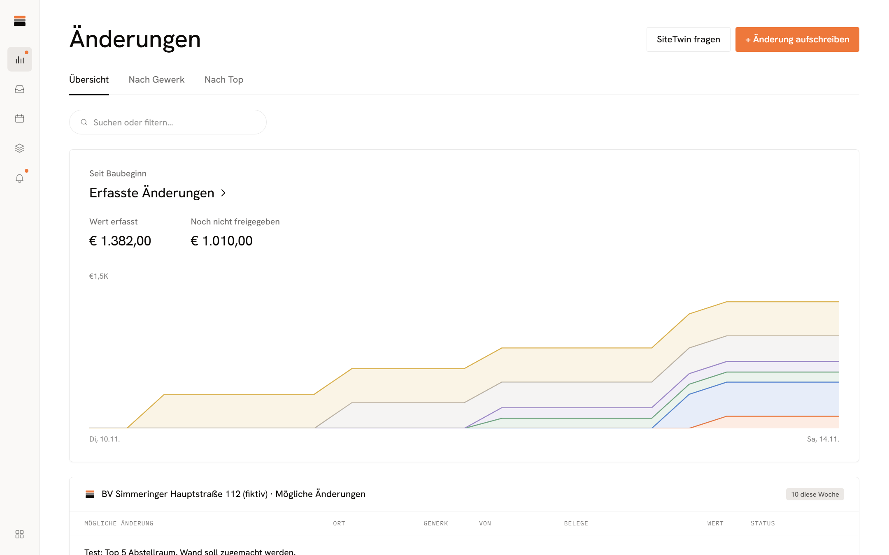
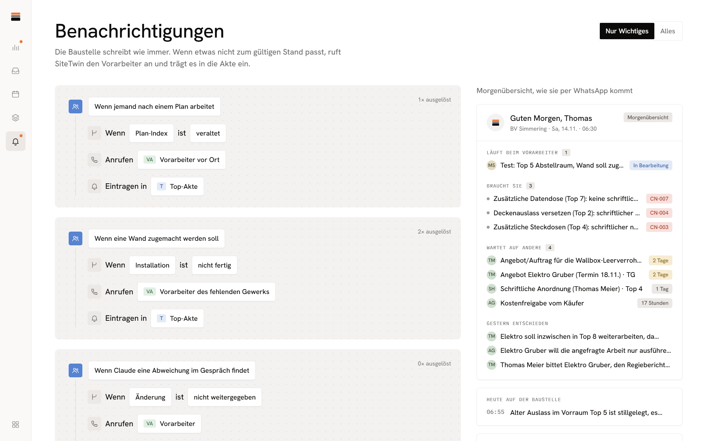
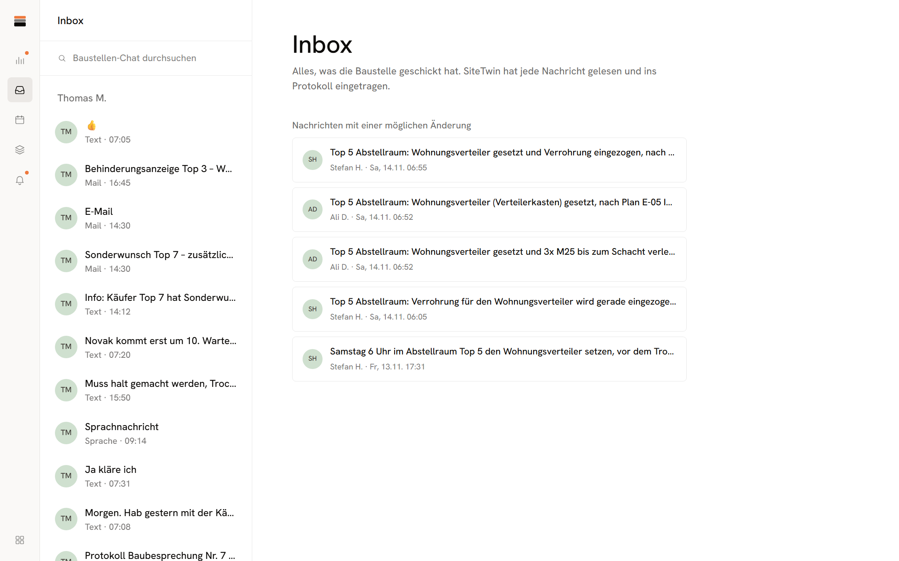
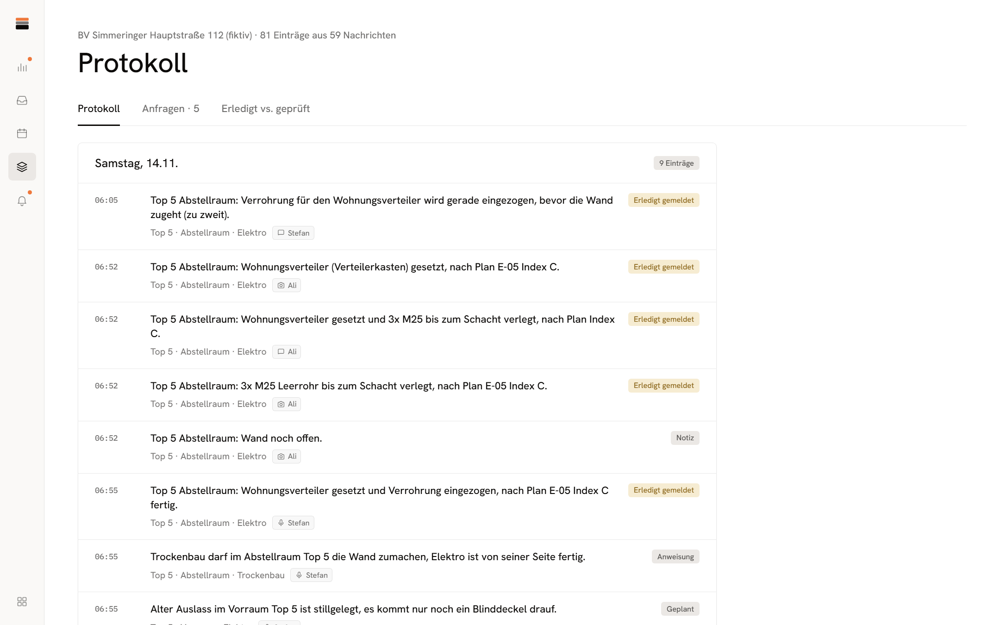

<h1 align="center">SiteTwin</h1>

<p align="center">
  <b>An AI agent that reads along in a building site's WhatsApp groups, mails and drawings, and warns before a crew builds on an outdated plan.</b><br />
  Built for <a href="https://talona.ai">Talona</a> at the Building Better Worlds Hackathon, 13–14 November 2026
</p>

<p align="center">
  <a href="https://sitetwin-hendriks-projects-491d3237.vercel.app">Live demo</a> ·
  <a href="https://youtu.be/edz0X3kRlAY">Demo video</a> ·
  <a href="docs/SETUP.md">Run it yourself</a>
</p>

<p align="center">
  <a href="https://youtu.be/edz0X3kRlAY">
    
  </a>
</p>

---

## The problem

On a residential building site, changes travel through group chats, mail threads and a shared folder. A planner sends a new drawing by mail, the electrician hears about it on Monday, and the drywall crew closes the wall on Saturday. Nobody did anything wrong, and the wall still has to be opened again. Tools that ask crews to type into yet another app do not help: the crews do not use them.

## The solution

SiteTwin docks onto the channels the site already uses. Nobody changes how they work. It keeps every message as raw evidence, turns it into a structured record, checks each new record against the valid drawing, and raises a **signal** while someone can still act: a warning in the WhatsApp group, a phone call to the person responsible, and a live view for the office.

## Architecture

<p align="center">
  
</p>

1. **Site channels.** WhatsApp messages (with photos and voice notes), mails, files in a Drive folder and phone call transcripts.
2. **Ablage (ingest).** Stores every source unchanged, so each later claim can be traced back to the original message. Voice notes and PDFs become text; the same message arriving twice is stored once.
3. **Übersetzer (structure).** Claude turns each new source into entries: what, where (unit, room, component), who, when, which drawing, who decided and who is waiting on whom.
4. **Prüf-Agent (check).** Fixed rules, plus a Claude check for what the rules miss, compare each entry with the valid drawing. Example: the drywall crew announces it will close a wall where the electricians have not yet run their pipes.
5. **Act.** The signal goes to the crew in their WhatsApp group and to the person responsible by phone; the office sees every project live in the web app and can ask questions answered only from the record. The call transcript comes back in as a new source, and the crew's rating of a warning (justified or false alarm) feeds back into the check.

The German names (Ablage, Übersetzer, Prüf-Agent) are kept on purpose: the domain is a German-speaking building site, so the prompts, test data and messages to the crew are German too.

## Screenshots

All data is fictional. The fictional project is "BV Simmering", a residential building in Vienna.

| Changes per unit, with their sources | Signals and the rules behind them |
|---|---|
|  |  |
| **Inbox: every message from the site** | **Record: what changed, who reported it** |
|  |  |

## Tech stack

| Part | Built with |
|---|---|
| Ingest (`ablage/`) | Python, FastAPI; WhatsApp reader in Node.js (Baileys); Gmail and Drive via n8n |
| Structuring and checking (`uebersetzer/`) | Python, Claude with structured output |
| Database | Supabase (Postgres and Storage) |
| Phone agent (`lib/telefon/`) | ElevenLabs voice agent with a Twilio number |
| Web app (`app/`, `components/`, `lib/`) | Next.js, TypeScript, hosted on Vercel |

## Run it yourself

Setup, environment variables, the demo walkthrough and an honest list of what ran for real and what did not: **[docs/SETUP.md](docs/SETUP.md)**.

| What | Command |
|---|---|
| Web app | `npm install && npm run dev` (http://localhost:3000, needs Supabase in `.env.local`) |
| Import the fictional data | `cd ablage && pip install -e . && python -m ablage import whatsapp ../fake_data/whatsapp --projekt "BV Simmering"` |
| Structure and check | `cd uebersetzer && uv sync && uv run python -m uebersetzer lauf` |
| Tests (no network needed) | `npm test` · `cd ablage && python -m pytest -q` · `cd uebersetzer && uv run pytest` |

Working with an AI coding assistant? [`CLAUDE.md`](CLAUDE.md) gives it the map of the repository.

## Repository layout

```
ablage/        ingest layer (Python), n8n flows, WhatsApp reader (Node.js)
uebersetzer/   Übersetzer and Prüf-Agent (Python), database schema
fake_data/     fictional test data and scenarios
app/           Next.js routes and API
components/    web app UI
lib/           database access, view model, phone agent
docs/          setup guide, images, archived hackathon submission
```

`/v1` is the first prototype from the start of the hackathon (its own rule engine and a 3D model, not connected to the database chain). Further docs: [`KONZEPT.md`](KONZEPT.md) (core idea, German), [`ablage/README.md`](ablage/README.md), [`uebersetzer/README.md`](uebersetzer/README.md).

## Team

Team Claudemaxxers

| | |
|---|---|
| Maximilian Dieringer | [LinkedIn](https://www.linkedin.com/in/maximilian-dieringer/) |
| Santino Schrader | [LinkedIn](https://www.linkedin.com/in/santino-schrader/) |
| Hendrik Boettcher | [LinkedIn](https://www.linkedin.com/in/hendrikboettcher/) |
| Melih Kurtulmus | [LinkedIn](https://www.linkedin.com/in/melih-kurtulmus/) |

## Rights

Built for Talona in the Talona track of the Building Better Worlds Hackathon. The work belongs to Talona and is shown here with their permission. It is not published under an open-source license.
